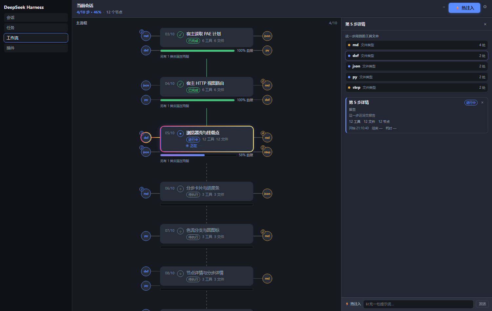

# dsh-workflow-map

English · [**简体中文**](README.md)

A DeepSeek Harness plugin that renders the current session as an interactive step-by-step workflow map.

Three entry points share one data source and one set of components: the sidebar panel item
(`sidebar.panellist`), the main content area (`main`), and the session tab bar (`conversation.view`).
The panel folds session events into a step sequence, showing each step's status, progress, tool calls
and file operations, and can inject prompts into the next step of a running session.



*Left: the selected sidebar entry. Centre: the serial main flow (one unit card per step, round interfaces
on both sides for tool/file types; the running unit is highlighted with a flowing frame). Right: the page
opened for a step (type list, step detail). Bottom: the persistent injection bar.*


---

## 1. What problem it solves

Long tasks grow session logs to thousands of events. Answering "which step is it on", "what did this
step do" and "how much is done" means scrolling back through those logs. This plugin presents those
three facts on one screen, with every data source and decision rule traceable.

### Layout

```
┌──────────────────────────────┬───────────────────┐
│ session         4/10 · 46%                 ⚙ │
├──────────────────────────────┼───────────────────┤
│ ◯─┐  01/10  skeleton and registration │  step 5 detail       │
│   │   ▓▓▓▓▓▓▓▓▓▓ 100% reported │  ──────────────── │
│   │                            │  files this step used │
│ ◯─┘  02/10  host projection      │  ● md type   4 calls │
│   │   ▓▓▓▓▓▓▓▓▓▓ 100% reported │  ● js type   2 calls │
│   │                            │  ● pwsh type 2 calls │
│ ◯─┐  05/10  browser shell       <- running (highlighted) │
│   │   ▓▓▓▓▓░░░░░ ~58% estimated │  step 5 detail      │
│   │   estimated 3 min ago       │  what it delivered  │
│   │                            │  ● done              │
│ ◯─┘  06/10  step cards and rail │  12 tools 12 files │
│       ▓▓▓░░░░░░░ ~36% estimated │  ──────────────── │
│                                │  inject [........] │
└──────────────────────────────┴───────────────────┘
   main flow (one unit per step, round type interfaces on both sides)   right page (opens on click)
```

> Diagram, not a screenshot; see the screenshot above for the real UI.

---

## 2. Capabilities

The four capabilities below map onto four regions of the UI: injection (header button and the right
page input), progress (the rail under each card), layout (main flow and side interfaces), and state
encoding (animation and colour).

### 2.1 Hot injection (steer / unsteer)

This section states the write semantics, state determination and failure semantics of the injection channel.
All three are derived from session log events; the front end does not guess.
**Write semantics**: `POST /dsh-workflow/steer` calls the host's `agent.steer(message)`; the message
enters the session inbox queue `next-step` and is claimed by the next step **after the current turn
ends**. The call does not trigger `cancel`, so the running turn is not interrupted.

| Endpoint | Method | Semantics |
|---|---|---|
| `/dsh-workflow/steer` | POST | Write one prompt to `next-step`; the response returns the generated `messageId` |
| `/dsh-workflow/unsteer` | POST | Call `agent.inbox.remove()` with the `messageId`, removing a message that is **not yet claimed** |

**State determination** (mutually exclusive, all derived from the log, never guessed by the UI):

| State | Determined by |
|---|---|
| Awaiting pickup | `agent/inbox/spliced` exists and no `user/message` with the same id |
| Picked up | A `user/message` with the same id exists (the turn claimed it) |
| Revoked | `agent/inbox/spliced { outcome: "canceled" }` exists and the id was never claimed |

HTTP 200 only means the message reached the inbox; it does **not** mean the session has read it. The
"awaiting pickup" versus "picked up" distinction comes from the log events above. A revoke's durable
record is the splice **position**, not the message id, so the fold keeps an inbox ledger (replaying
splices with the host's own `inboxProjectionDefinition` semantics) to identify which row was removed.

Failure semantics: document-level errors always return JSON and never throw into the HTTP layer.
Common codes: `400` missing field / non-JSON body, `404` unknown session, `409` session not running or
message already claimed, `413` text over 2000 chars or body over 64 KiB, `503` the host does not expose
the capability.

### 2.2 Progress estimation

This section states the percentage priority order, the algorithm and cap of each source, and the definition
of the staleness field. The rule is implemented by `percentFor` in `src/fold.mjs`.

Each step's percentage is resolved by the following **priority** (`percentFor` in `src/fold.mjs`):
| Priority | Source | Rule | Cap |
|---|---|---|---|
| 1 | Todo table `todos` | `round(completed / total * 100)`; when a self-report exists, this measured value is still what is returned | 99 |
| 2 | Model self-report `model` | Only when the todo table has no countable rows: the **larger** of the `stepProgress/report` percentage and the self-report high-water mark | 100 |
| 3 | Time baseline `baseline` | `elapsed / median(finished-step durations in this session) * 100` | 90 |
| 4 | Plan ordinal `baseline:steps` | Cold start with `current step / total steps * 100` when no durations exist | 90 |
| - | `none` | None of the four is available | No number shown |

Constraint: an unfinished step never shows 100 %; a finished (done or failed) step is pinned to 100 %.

The choice follows verifiability: the todo table is an objective count, a model self-report is not. So
whenever the todo table has completed rows, the percentage is that measured ratio (both branches of that
`percentFor` expression yield `measured`); the self-report is a fallback only when no row can be measured.
The high-water record `step.maxPercent` is still kept and never rolled back, but it no longer takes part in
computing the displayed value.

A second line under the rail reads `estimated N minutes ago`, i.e. `view.asOf - step.lastEstimateAt`.
It describes how **stale** the number is, distinguishing "being updated" from "unchanged for a long time".
The line is not rendered when the field is absent.

### 2.3 Single-page layout

One vertical main flow, one unit per step; each unit carries round interfaces on both sides, one per
tool or file type.

| Dimension | Rule |
|---|---|
| Side assignment | Read-type (`read` / `grep` / `glob` / path queries) on the left; write and execute (`edit` / `write` / `pwsh`) on the right |
| Capacity per side | 2 interfaces |
| Overflow | Extra types are not drawn; the unit states "N more types are not drawn on the sides" |
| Connector | A straight line between interface and unit |
| Details | Click an interface -> the right page lists that type's calls; click a unit -> the right page shows that step's record |

A single page was chosen over columns for continuity: switching steps in a two-column layout moves two
scroll regions at once, whereas here the main flow does not shift when the right page opens or closes.

### 2.4 Visual state encoding

The running unit and the single connector pointing at it use a flowing gradient; every other unit stays
statically filled even when its status is `running` (for example, when it is not the live one). Durations
and thresholds live in `src/client/theme.js`:

| Element | Implementation | Period |
|---|---|---|
| Running unit frame | `::after` multi-stop linear gradient plus a position animation | 2.6 s |
| Running unit ring | Opacity pulse | 1.6 s |
| Progress fill | Background position | 1.5 s |
| Activity dots | Three dots breathing out of phase | 1.2 s |

`data-motion="static"` (the "reduce motion" setting, or the OS `prefers-reduced-motion: reduce`) sets
every animation inside the panel to `none`, and `document.getAnimations()` returns an empty set;
`data-idle="1"` (session idle) sets animations to `paused` while keeping the current frame. The two are
not the same thing.

### 2.5 One implementation, three seats

All three entries register the same component, the same polling and the same preferences record - there is
no second implementation. The session-tab entry additionally carries a box-less marker so a `:has()` rule
can collapse the host's composer on that page; switching back unmounts the view and the composer returns.

---

## 3. Installation

> **Prerequisites for installing from the market**: two conditions must both hold. (1) `dsh-workflow-map`
> is published on npm (currently `0.3.1`). (2) The `awesome-dsh-plugin` PR is merged **and** the market index
> (`dsh-plugin-catalog`, served via jsDelivr) has refreshed and picked up the entry.
> Once both hold, install from the **DSH market** (Plugins > Discover) by searching `workflow`, no terminal needed.
> If it is not indexed yet, use the command line below (3.2) to install the same package; both routes are equivalent.

### 3.1 Install through the agent

```
install dsh-workflow-map with plugin_manager, path is <absolute path to the plugin>
```

A returned `application: applied` means it took effect; no other value does.

### 3.2 Command line

```bash
cd "$HOME/.dsh/profiles/desktop"
pnpm add dsh-workflow-map
```

```powershell
# One command into the desktop profile (the bundled DSH CLI forwards the rest to that profile's pnpm; use the full path if it is not on PATH)
dsh plugin --profile desktop add dsh-workflow-map
```

Then append `"dsh-workflow-map"` to the `dsh.profile.bundles` array in that directory's `package.json`.

### 3.3 Local source

```bash
cd "$HOME/.dsh/profiles/desktop"
pnpm add "dsh-workflow-map@link:/path/to/dsh-workflow-map"
```

`link:` creates a symlink, so source edits are reflected on disk immediately.

### 3.4 Verify the install

```bash
# 1) the package is on disk
ls "$HOME/.dsh/profiles/desktop/node_modules/dsh-workflow-map"

# 2) the host view endpoint works (expect HTTP 200 and a JSON body)
curl -i "http://127.0.0.1:<GUI port>/dsh-workflow/state?sessionId=<session id>"

# 3) the UI: a clickable sidebar icon, a panel in the main area, a same-named tab in the session tab bar
```

---

## 4. How changes take effect

The plugin has two halves with different load times:

| Half | Contains | Takes effect | Why |
|---|---|---|---|
| Browser half | `client.js` (built from `src/client/*.js`) | **Page refresh (F5)** | Front-end code loads per request |
| Host half | `lib/index.js`, `src/fold.mjs`, `src/route.js` | **Restart the DSH process** | ESM module cache cannot be replaced in-process |

Restart once after the first install; afterwards UI-only changes need no restart.

---

## 5. Data boundary

### 5.1 What is read

- **Session event log**: `todo/write`, `tool/call`, `tool/result`, `step/start|end`, `turn/start|end`,
  `stepProgress/report`, `user/message`, `assistant/message`, `approval/*`, `agent/inbox/*` and others.
  Event types not listed return the same state reference with no copy.
- **PAE plan file**: `<project>/.pae/<sessionId>/orchestrator.json`. Read-only, cached by `mtime:size` and
  re-parsed only when the file changes; the parsed result is deep-frozen. A missing file, a partial write or
  malformed fields yield `null` and degrade to the todo table only, never throwing.

### 5.2 What is not read

- **File bodies**. Fields such as `content`, `old_str` and `new_str` never enter the state, so how much
  the agent writes does not grow the panel's state.
- **The network**. The plugin makes no outbound requests; all data comes from local processes and files.

### 5.3 Truncation and limits

| Item | Limit | On overflow |
|---|---|---|
| Arguments / result text | 200 characters each | The UI states "host cap 200 characters" |
| Nodes per step | 300 | Keep head and tail, drop the middle into `truncated.stepNodes` |
| Nodes per session | 1200 | Evict starting from the step with the most nodes; no step is ever emptied |
| Injection history | 40 rows | Keep the newest |
| Approval records | 40 rows | Keep the newest |
| Titles | 120 characters | Truncated with an ellipsis |

Eviction deliberately does not start with the oldest: the oldest nodes usually belong to finished steps,
so time-based eviction would empty historical steps.

---

## 6. Interaction

| Action | Result |
|---|---|
| Click a unit | The right page shows that step's record (report, artifacts, stats) |
| Click a round interface | The right page lists that type's calls |
| Click a call row | Expand the full arguments, result and error in place |
| `Esc` | Close the right page, not the panel |
| Gear | Open settings: palette, motion, detail depth, node limit |
| Copy control | Copy path / command / snapshot, with a receipt that restores after 1.5 s |

Settings:

| Item | Values | Effect |
|---|---|---|
| Palette `palette` | `rainbow` / `brand` / `soft` | Switches accent colours and gradients |
| Motion `motion` | `full` / `always` / `static` | `full` follows session activity; `always` plays even when idle; `static` turns everything off |
| Detail depth `detail` | `summary` / `title` | `title` hides the rail's second line |
| Node limit `nodeLimit` | 30 / 60 / 120 / 0 | `0` means unlimited |

Preferences live in one `localStorage` record; a corrupted or outdated record degrades field by field to the
 defaults without blocking rendering.

---

## 7. Export

The gear offers four exports: copy / download times Markdown / JSON. The exported snapshot contains the
steps, their status, the percentage source, the node list and the report artifact paths - never file bodies.

---

## 8. Compatibility and constraints

- **DeepSeek Harness** 0.2.x or newer (relies on session projections and `webServer` route registration).
- **Node.js** ≥ 20。
- The three endpoints mount on the host's existing port; **no new listener** is opened.
- The composer is rendered by the host and is not part of this plugin. The plugin neither replaces nor
  overlays it; it only yields space on the session-tab page through a stylesheet rule.
- The fold path never reads a clock: every time value in the view comes from event timestamps, so the same
  event sequence always yields the same view (replayable).

---

## 9. Development

```bash
# after editing src/client/*.js, rebuild the browser half
node tools/build-client.mjs

# offline self-tests (10 suites, 1507 assertions)
node tools/selftest-fold.mjs          # fold semantics
node tools/selftest-host.mjs          # registration, schema, projection wiring
node tools/selftest-orchestrator.mjs  # plan file reading and merging
node tools/selftest-shape.mjs         # package shape, config, files whitelist
node tools/selftest-panel.mjs         # render tree, styles, interaction
node tools/selftest-detail.mjs        # node and step details
node tools/selftest-effects.mjs       # animation and motion fallback
node tools/selftest-settings.mjs      # settings and export
node tools/probe-route.mjs            # HTTP routes (real loopback)
node tools/probe-steer.mjs            # injection / revoke channel

# read-only regression over real logs
node tools/check-real-injects.mjs     # fold historical logs in bulk
node tools/audit-real.mjs             # four-constraint audit
```

Browser measurements (needs a Chromium; the scripts auto-detect Chrome / Edge; 308 assertions):

```bash
pwsh -File tools/measure-panel.ps1
pwsh -File tools/measure-timing.ps1
pwsh -File tools/measure-inject.ps1
pwsh -File tools/measure-dock.ps1
pwsh -File tools/measure-flow.ps1
pwsh -File tools/measure-effects.ps1
pwsh -File tools/measure-branches.ps1
pwsh -File tools/measure-detail.ps1
pwsh -File tools/measure-settings.ps1
pwsh -File tools/measure-main.ps1
```

`client.js` is a build artifact (its first line carries a GENERATED marker) and must not be edited by hand.
`tools/retired/` holds historical scripts for removed UI; they are not part of the verification chain.

---

## 10. Key constants

Every threshold is defined once and asserted by the tests, so this table cannot drift from the code:

| Constant | Value | Location | Meaning |
|---|---|---|---|
| `NODES_PER_STEP` | 300 | `src/fold.mjs` | Nodes per step |
| `NODES_TOTAL` | 1200 | `src/fold.mjs` | Nodes per session |
| `TEXT_LIMIT` | 200 | `src/fold.mjs` | Argument and result text |
| `TITLE_LIMIT` | 120 | `src/fold.mjs` | Titles |
| `INJECT_LIMIT` | 40 | `src/fold.mjs` | Injection history retained |
| `APPROVAL_LIMIT` | 40 | `src/fold.mjs` | Approval records retained |
| `WF_SIDE_SLOTS` | 2 | `src/client/theme.js` | Interfaces per side |
| `WF_STEP_RAIL` | 6 | `src/client/theme.js` | Progress rail height (px) |
| `WF_FLOW_CAP` | 60 | `src/client/theme.js` | Default call-list window |
| Request body | 2000 chars / 64 KiB | `src/route.js` | Injection request limit |

---

## 11. Known issues

Both defects recorded in 0.3.0 are closed:

| Original # | Symptom | Status |
|---|---|---|
| 1 | With the brand palette the running unit's frame used the default gradient | Fixed (`8bf6f2c`); the same residue under the `soft` palette was fixed in 0.3.1 |
| 2 | The type page subtitle showed an unsubstituted `{count}` placeholder | Fixed (`8bf6f2c`) |

There are no known functional defects at present. Changes to the host half need a DSH process restart;
that is how activation works, not a defect.

---

## 12. Layout

```
dsh-workflow-map/
├─ index.js                  package entry (re-exports lib/index.js)
├─ lib/index.js              host half: session projection + three HTTP endpoints
├─ src/
│  ├─ fold.mjs               events -> state -> view (pure, no clock, no IO)
│  ├─ orchestrator.mjs       read-only PAE plan file
│  ├─ route.js               /state · /steer · /unsteer
│  └─ client/                browser-half sources (inlined into one file at build)
├─ client.js                 build artifact
├─ cordis.patch.yml          mount declaration
├─ locale/{zh,en}.json       dictionaries
├─ docs/                     release guide
└─ tools/                    self-tests · probes · browser measurements
```

---

## 13. FAQ

**Can it show several sessions at once?**
The panel shows the current session only. Switching sessions switches the content; nothing is merged or tiled.

**Does it slow DSH down?**
The fold is pure with no IO; the view is derived from state, and state has hard limits (300 nodes per step,
1200 per session). Polling compares `rev` first and returns 304 without rebuilding when nothing changed.
File bodies never enter the state.

**Why does the percentage sometimes stay still for a long time?**
The number only moves when new events arrive. When neither the todo table nor the report updates, the time
baseline creeps up but is capped at 90 %. The second line ("estimated N minutes ago") states how stale it is.

**Why does an unfinished step never reach 100 %?**
The todo table caps at 99 and the time baseline at 90; only a done/failed status pins 100 %. This keeps
"nearly there" from being confused with "already there".

**Does it upload my code?**
No. The plugin makes no network requests; it reads only the local session log and the `.pae` plan file.

**Can I install only the UI and skip the host half?**
No. Both halves belong to one package: `dsh.profile.bundles` registers the host row, and the browser half is
loaded by that row.

**Can I turn animation off?**
Set motion to `static` in the settings, or enable "reduce motion" in the OS; both set every animation inside
the panel to `none`.

---

## 14. License

MIT. Commercial use, modification and redistribution are permitted; keep the copyright notice.

---

## 15. Reporting an issue

The following helps locate a problem:

1. DSH version and plugin version (`version` in `package.json`);
2. The response body of `GET /dsh-workflow/state?sessionId=<id>` - **it contains task titles and file
   paths, so redact before posting**;
3. A screenshot of the panel where it goes wrong;
4. For fold-related issues, include the relevant event sequence from that session log.
