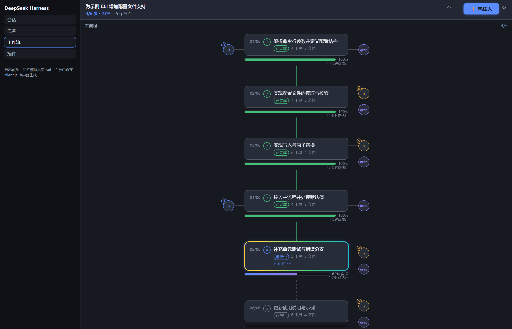
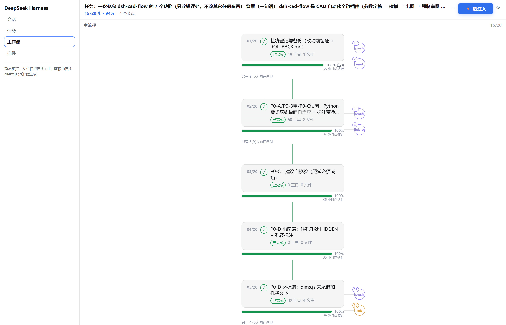
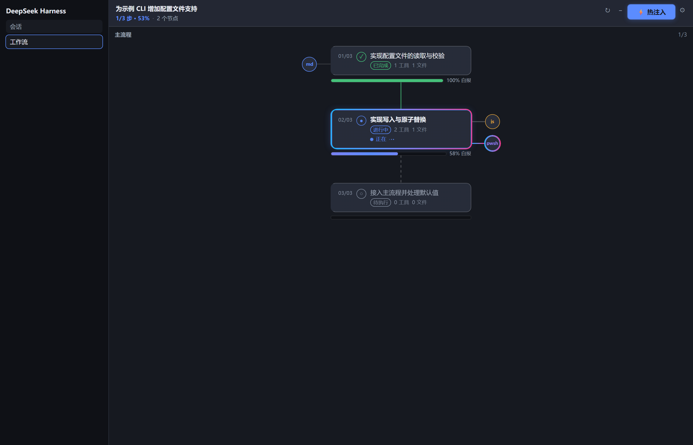
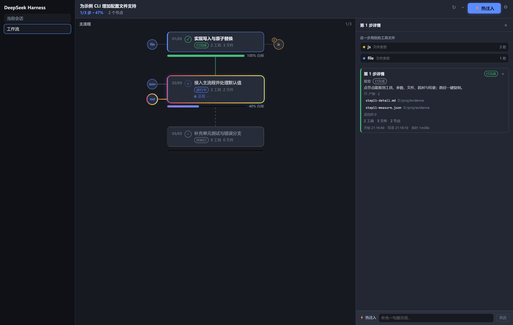
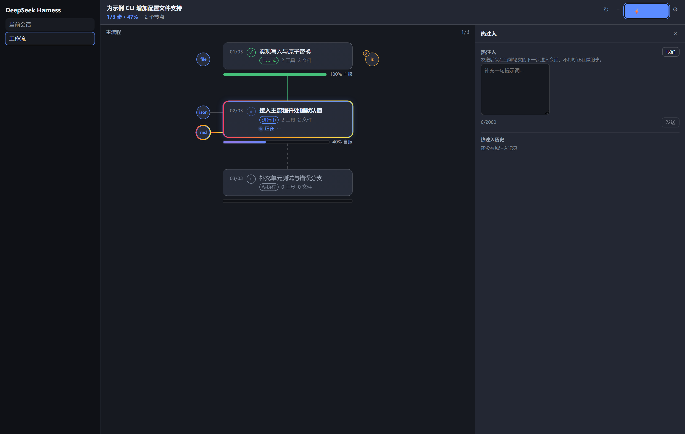
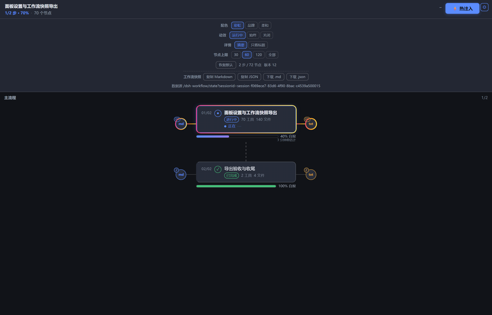

# dsh-workflow-map

[**English**](README.en.md) · 简体中文

DeepSeek Harness 插件：把当前会话渲染为一张可交互的分步工作流地图。

https://github.com/deepseek-ai/deepseek-harness/discussions/11660

>  **宿主适配要求（Host requirement）**
> - **DSH 内核**：`engines.dsh` = `>=0.2.1-rc.1 <0.3.0-0`，覆盖 `0.2.1` 全系列（`0.2.1-rc.1` 至 `0.2.1-rc.5`）与 `0.2.1` 正式版。
> - **Node.js**：`>=20`（`engines.node`）。
> - 宿主包以 `peerDependencies` 声明（均为可选 peer，区间与 `engines.dsh` 一致），不打包宿主；低于 `0.2.1-rc.1` 或 `0.3.0` 及以上的宿主不在声明范围内。
> - 区间写法：`>=0.2.1-rc.1 <0.3.0-0` 在 `0.2.1` 元组上带显式预发布标签，才能匹配 `0.2.1-rc.x`；起点若写 `>=0.1.0-rc.1`，`0.2.1` 的预发布版本会被静默排除。上界 `<0.3.0-0` 小于 `0.3.0` 的任何预发布版本，因此整条 `0.3` 线（含 `0.3.0-rc.1`）都在区间外。

逐版本核验方式与结论：

| 宿主版本 | 核验方式 | 结论 |
|---|---|---|
| `0.2.1-rc.3` | 实机运行：插件加载、面板注入、视图路由 | 基线版本 |
| `0.2.1-rc.1` / `0.2.1-rc.2` / `0.2.1-rc.4` / `0.2.1-rc.5` | 跨版本契约核验：闭包元数据、逐文件 SHA-256、契约锚点窗口 | 九个契约点未变 |

契约核验不等于实机运行：上表后四个版本只处理已发布的产物与契约锚点，未启动宿主。方法与证据见 [`docs/host-compatibility.md`](docs/host-compatibility.md)。

三个入口共用同一份数据与同一套组件：侧边栏面板项（`sidebar.panellist`）、主内容区（`main`）、
会话标签栏（`conversation.view`）。面板将会话事件折叠为分步序列，展示每步的状态、进度、
工具调用与文件操作，并支持在会话运行中向其下一步注入提示词。



*主界面（深色）：左为侧边栏入口选中态，中为串行主流程（每步一张单元卡，两侧圆形接口为工具/文件
类型，运行中的单元高亮并带流动外框），右为分步详情页，底部为常驻注入条。*

### 界面截图（完整预览）

| | |
|---|---|
|  |  |
| **主界面 · 浅色主题** —— 与深色同一布局，配色随宿主主题切换 | **运行中的单元** —— 流动渐变外框标出「此刻在调用」 |
|  |  |
| **分步详情** —— 右页列出该步的类型清单、调用参数与结果摘要 | **热注入** —— 提示词排入下一步执行队列，被取用前可撤回 |
|  | |

以上六张为离屏渲染的界面预览，不含任何真实会话内容。


---

## 1. 它解决什么问题

长任务的会话日志会增长到上千条事件。定位「当前处于第几步」「这一步做了什么」「已经完成多少」
需要在日志中回溯。本插件把这三类信息呈现为一屏可读的视图，数据来源与判定规则全部可追溯。

### 界面结构

```
┌──────────────────────────────┬───────────────────┐
│ 当前会话            4/10 · 46%              ⚙ │
├──────────────────────────────┼───────────────────┤
│ ◯─┐  01/10  骨架与最小注册   │  第 5 步详情      │
│   │   ▓▓▓▓▓▓▓▓▓▓ 100% 自报  │  ──────────────── │
│   │                        │  这一步骤调用的    │
│ ◯─┘  02/10  宿主投影与折叠   │  ● md 类型  4 处  │
│   │   ▓▓▓▓▓▓▓▓▓▓ 100% 自报  │  ● js 类型  2 处  │
│   │                        │  ● pwsh类型 2 处  │
│ ◯─┐  05/10  浏览器壳与挂载点 ← 运行中（高亮） │
│   │   ▓▓▓▓▓░░░░░ ~58% 估算  │  第 5 步详情      │
│   │   3 分钟前估计          │  这一步骤交了什么 │
│   │                        │  ● 已完成         │
│ ◯─┘  06/10  分步卡片与进度条 │  12 工具 12 文件  │
│       ▓▓▓░░░░░░░ ~36% 估算  │  ──────────────── │
│                              │  热注入 [.......] │
└──────────────────────────────┴───────────────────┘
   主流程（每步一个单元，两侧圆点为类型接口）   右页（点击后打开）
```

> 示意图，非截图；实际界面见上方截图。

---

## 2. 核心能力

以下四块能力对应界面上的四个区域：注入（页头按钮与右页输入条）、进度（卡片下方轨道）、
布局（主流程与两侧接口）、状态编码（动画与配色）。

### 2.1 热注入（steer / unsteer）

**写入语义**：`POST /dsh-workflow/steer` 调用宿主的 `agent.steer(message)`，消息进入会话收件箱的
`next-step` 队列，在**当前轮次结束后**由下一步取用。调用不触发 `cancel`，因此不中断正在执行的轮次。

| 端点 | 方法 | 语义 |
|---|---|---|
| `/dsh-workflow/steer` | POST | 写入一条提示词到 `next-step`；响应返回本次生成的 `messageId` |
| `/dsh-workflow/unsteer` | POST | 按 `messageId` 调用 `agent.inbox.remove()`，把**尚未被取用**的消息移出收件箱 |

**状态判定**（三者互斥，均由日志派生，不由前端推测）：

| 状态 | 判定依据 |
|---|---|
| 待拾取 | 存在 `agent/inbox/spliced` 且无同 id 的 `user/message` |
| 已接下 | 存在同 id 的 `user/message`（轮次已 claim） |
| 已撤销 | 存在 `agent/inbox/spliced { outcome: "canceled" }` 且该 id 未被 claim |

HTTP 200 仅表示消息已进入收件箱，**不等价于**会话已读取；「待拾取」与「已接下」的区别由上述日志
事件区分。撤回的持久记录是 splice 的**位置**而非消息 id，因此折叠侧维护一份收件箱台账
（按宿主 `inboxProjectionDefinition` 的 splice 语义逐条重放）才能定位被移除的具体行。

失败语义：文档型错误一律返回 JSON，不向 HTTP 层抛出异常。常见状态码：`400` 缺字段 /
body 非 JSON，`404` 会话不存在，`409` 会话未在运行或消息已被取用，`413` 文本超 2000 字或
body 超 64 KiB，`503` 宿主未暴露相应能力。

### 2.2 进度估算

每步的百分比按以下**优先级**取值（`src/fold.mjs` 的 `percentFor`）：
| 优先级 | 来源 | 计算规则 | 上限 |
|---|---|---|---|
| 1 | 待办表实测 `todos` | `round(已完成项 / 总项 × 100)`；自报存在时也只取该实测值 | 99 |
| 2 | 模型自报 `model` | 待办表无可计行时，取最近一次 `stepProgress/report` 的百分比 | 99 |
| 3 | 时间基线 `baseline` | `elapsed / median(本会话已完步耗时) × 100` | 90 |
| 4 | 计划步序 `baseline:steps` | 无历史耗时时，用 `当前步序 / 总步数 × 100` 冷启动 | 90 |
| — | `none` | 四个来源均不可用 | 不显示数字 |

约束：未结束的步不会显示 100%；已结束（完成或失败）的步固定为 100%。

选用规则依据可核验性：待办表是逐行计数得到的量值，模型自报没有对应的行级依据。因此只要待办表存在已完成行，
百分比取该计数比值（`percentFor` 的两个分支均返回 `measured`），自报仅在无行可计数时作为备选；且取
**最近一次**自报，使后续报告能够改变显示值。高水位记录 `step.maxPercent` 保留且不回退，不参与显示值计算。
`foldTodos` 将已结束行改回 `in_progress`、或降级为 `pending` 时，清空 `percent` 与 `maxPercent` 并重置
`startedAt`：已结束记录的数字属于那一次结束，不属于重新打开它的行。

进度条下方另有一行元信息：`N 分钟前估计`，即 `view.asOf − step.lastEstimateAt`。
该值描述数字的**陈旧程度**，用于区分「正在更新」与「长时间未更新」。字段缺失时整行不渲染。

### 2.3 单页布局

一条纵向主流程，每步一个单元；单元左右两侧各挂若干**圆形接口**，每个接口对应一类工具或文件类型。

| 维度 | 规则 |
|---|---|
| 分侧依据 | 读取类（`read` / `grep` / `glob` / 路径查询）在左；写入与执行类（`edit` / `write` / `pwsh`）在右 |
| 每侧容量 | 2 个接口 |
| 溢出处理 | 超出部分不渲染，单元上标注「另有 N 类未画在两侧」 |
| 连接 | 接口与单元之间为直线 |
| 详情 | 点接口 → 右页展示该类调用清单；点单元 → 右页展示该步记录 |

选择单页而非多列的理由是上下文连续性：两列布局在切换分步时会同时改变两个滚动区的位置，
单页布局下主流程位置不随右页开合而变动。

### 2.4 视觉状态编码

运行中的单元及其唯一一条指向它的连接线使用流动渐变；其余单元即使状态为 `running`（例如已失焦）
也只做静态填充。动画时长与阈值定义在 `src/client/theme.js`：

| 元素 | 实现 | 周期 |
|---|---|---|
| 运行单元外框 | `::after` 多色线性渐变背景 + 位移动画 | 2.6 s |
| 运行单元状态环 | 不透明度脉动 | 1.6 s |
| 进度条填充 | 背景位移 | 1.5 s |
| 活动指示点 | 三点错相呼吸 | 1.2 s |

`data-motion="static"`（设置项「减少动效」，或系统 `prefers-reduced-motion: reduce`）会把面板内
所有动画置为 `none`，此时 `document.getAnimations()` 返回空集；`data-idle="1"`（会话空闲）
则将动画置为 `paused` 而保留当前帧，两者语义不同。

### 2.5 三入口一致性

三个入口注册的是同一个组件、同一份轮询与同一份偏好记录，不存在第二套实现。
会话标签栏入口额外携带一个无边盒标记，配合 `:has()` 规则在那一页收起宿主渲染的输入框；
切回对话页由宿主卸载该视图后自动恢复。

---

## 3. 安装

> **市场安装的前提**：该入口要求同时满足两个条件。（1）`dsh-workflow-map` 已发布到 npm（当前为 `0.3.4`）；
> （2）`awesome-dsh-plugin` 的 PR 已合并，且市场索引（`dsh-plugin-catalog`，经 jsDelivr 分发）已刷新收录该条目。
> 满足后在 **DSH 市场**（Plugins → Discover）搜索 `workflow` 即可安装，无需命令行；
> 若尚未收录，使用下面的命令行方式（3.2）安装同一个包，两者效果一致。

### 3.1 通过 agent 安装

```
用 plugin_manager 安装 dsh-workflow-map，路径是 <插件绝对路径>
```

返回 `application: applied` 表示已生效；其余取值均不代表生效。

### 3.2 命令行安装

```bash
cd "$HOME/.dsh/profiles/desktop"
pnpm add dsh-workflow-map
```

```powershell
# 一条命令装到 desktop profile（DSH 自带 CLI 会把余下参数转给该 profile 的 pnpm；未加进 PATH 时用全路径）
dsh plugin --profile desktop add dsh-workflow-map
```

随后把 `"dsh-workflow-map"` 追加到该目录 `package.json` 的 `dsh.profile.bundles` 数组末尾。

### 3.3 本地源码安装

```bash
cd "$HOME/.dsh/profiles/desktop"
pnpm add "dsh-workflow-map@link:/path/to/dsh-workflow-map"
```

`link:` 建立符号链接，源码改动即时反映到磁盘。

### 3.4 安装校验

```bash
# 1) 包已落盘
ls "$HOME/.dsh/profiles/desktop/node_modules/dsh-workflow-map"

# 2) 宿主视图端点可用（期望 HTTP 200 与 JSON body）
curl -i "http://127.0.0.1:<GUI端口>/dsh-workflow/state?sessionId=<会话ID>"

# 3) 界面：侧边栏图标可点、主内容区出现面板、会话标签栏出现同名页签
```

---

## 4. 生效机制

插件由两个半身组成，加载时机不同：

| 半身 | 包含 | 生效条件 | 原因 |
|---|---|---|---|
| 浏览器半 | `client.js`（由 `src/client/*.js` 构建） | **刷新页面（F5）** | 前端代码按请求加载 |
| 宿主半 | `lib/index.js`、`src/fold.mjs`、`src/route.js` | **重启 DSH 进程** | ESM 模块缓存，进程内不可替换 |

首次安装后需重启一次；此后仅调整界面无需重启。

---

## 5. 数据边界

### 5.1 读取范围

- **会话事件日志**：`todo/write`、`tool/call`、`tool/result`、`step/start|end`、`turn/start|end`、
  `stepProgress/report`、`user/message`、`assistant/message`、`approval/*`、`agent/inbox/*` 等。
  未列入的事件类型原样返回同一状态引用，不产生拷贝。
- **PAE 计划文件**：`<项目>/.pae/<会话ID>/orchestrator.json`。只读访问，以 `mtime:size` 为缓存键，
  仅在文件变化时重新解析；解析结果深冻结。文件缺失、写入中或字段异常时返回 `null` 并降级到
  仅用待办表，不抛出异常。

### 5.2 不读取的内容

- **文件正文**。`content`、`old_str`、`new_str` 等字段不进入状态；
  写入体量不影响面板状态大小。
- **网络**。插件不发起任何外部请求；全部数据来自本地进程与本地文件。

### 5.3 截断与上限

| 项 | 上限 | 超出行为 |
|---|---|---|
| 参数 / 结果文本 | 各 200 字 | 界面标注「宿主上限 200 字」 |
| 单步节点数 | 300 | 保留首尾、中间丢弃，计入 `truncated.stepNodes` |
| 全会话节点数 | 1200 | 从节点最多的步开始淘汰，单步不会被清空 |
| 注入历史 | 40 条 | 保留最新 |
| 审批记录 | 40 条 | 保留最新 |
| 标题 | 120 字 | 截断并加省略号 |

淘汰策略刻意不从「最老」开始：最老的节点通常属于已完成的步，按时间淘汰会清空历史分步。

---

## 6. 交互

| 操作 | 结果 |
|---|---|
| 点单元 | 右页展示该步记录（报告、产物、统计） |
| 点圆形接口 | 右页展示该类调用的清单 |
| 点调用行 | 就地展开参数全文、结果与错误 |
| `Esc` | 关闭右页，不关闭面板 |
| 齿轮 | 打开设置：配色、动效、详情深度、节点上限 |
| `↻` | 立即重新读取当前会话的视图；读取成功后按钮短暂显示「已刷新」 |
| 复制控件 | 复制路径 / 命令 / 快照，1.5 秒后回执并复原 |

视图由轮询获得：页面可见时每 0.8 秒一次，隐藏时每 3 秒一次，条件请求（`If-None-Match`），
未变化时宿主返回 `304` 且无响应体。`↻` 只是触发同一请求的一个周期，用于自动轮询受阻时手动取一次，
不改变轮询节奏，也不构成第二条数据通道。

设置项：

| 项 | 取值 | 作用 |
|---|---|---|
| 配色 `palette` | `rainbow` / `brand` / `soft` | 切换强调色与渐变 |
| 动效 `motion` | `full` / `always` / `static` | `full` 随会话活动启停；`always` 空闲也播放；`static` 全部关闭 |
| 详情深度 `detail` | `summary` / `title` | `title` 隐藏进度条第二行 |
| 节点上限 `nodeLimit` | 30 / 60 / 120 / 0 | `0` 表示不限制 |

偏好写入单条 `localStorage` 记录；记录损坏或版本过旧时逐字段退化为默认值，不阻断渲染。

---

## 7. 导出

齿轮内提供四种导出：复制 / 下载 × Markdown / JSON。导出内容为当前视图快照，
含分步、状态、百分比来源、节点清单与报告产物路径，不含文件正文。

---

## 8. 兼容性与约束

- **DeepSeek Harness**：`engines.dsh` 声明的区间 `>=0.2.1-rc.1 <0.3.0-0`（依赖会话投影与 `webServer` 路由注册）；`0.3.0` 及以后不支持。
- **Node.js** ≥ 20。
- 三个端点挂载在宿主既有端口上，**不新开监听**。
- 输入框（composer）由宿主渲染，不属于本插件。插件不替代、不覆盖该组件；仅在会话标签栏入口
  所在页通过样式规则使其让位。
- 折叠路径不读时钟：视图中所有时间量均来自事件时间戳，同一事件序列必得同一视图（可重放）。

---

## 9. 开发

```bash
# 修改 src/client/*.js 后必须重新生成浏览器半
node tools/build-client.mjs

# 离线自测（10 套）
node tools/selftest-fold.mjs          # 折叠语义
node tools/selftest-host.mjs          # 注册、schema、投影接线
node tools/selftest-orchestrator.mjs  # 计划文件读取与合并
node tools/selftest-shape.mjs         # 包骨架、配置、files 白名单
node tools/selftest-panel.mjs         # 渲染树、样式、交互
node tools/selftest-detail.mjs        # 节点与分步详情
node tools/selftest-effects.mjs       # 动画与动效降级
node tools/selftest-settings.mjs      # 设置与导出
node tools/probe-route.mjs            # HTTP 路由（真实 loopback）
node tools/probe-steer.mjs            # 注入 / 撤回通道

# 真实日志只读回归
node tools/check-real-injects.mjs     # 批量折叠历史日志
node tools/audit-real.mjs             # 四项约束审计
```

浏览器量测（需一份 Chromium，脚本自动探测 Chrome / Edge；含浅色/深色主题对比检查）：

```bash
pwsh -File tools/measure-panel.ps1
pwsh -File tools/measure-timing.ps1
pwsh -File tools/measure-inject.ps1
pwsh -File tools/measure-dock.ps1
pwsh -File tools/measure-flow.ps1
pwsh -File tools/measure-effects.ps1
pwsh -File tools/measure-branches.ps1
pwsh -File tools/measure-detail.ps1
pwsh -File tools/measure-settings.ps1
pwsh -File tools/measure-main.ps1
```

`client.js` 是构建产物（首行含 GENERATED 标记），不应手工修改。
`tools/retired/` 内为针对已移除界面的历史脚本，不属于验证链。

---

## 10. 关键常量

所有阈值集中定义，并由自测直接引用，因此本表取值与实现取值同源：

| 常量 | 值 | 位置 | 含义 |
|---|---|---|---|
| `NODES_PER_STEP` | 300 | `src/fold.mjs` | 单步节点上限 |
| `NODES_TOTAL` | 1200 | `src/fold.mjs` | 全会话节点上限 |
| `TEXT_LIMIT` | 200 | `src/fold.mjs` | 参数与结果文本上限 |
| `TITLE_LIMIT` | 120 | `src/fold.mjs` | 标题上限 |
| `INJECT_LIMIT` | 40 | `src/fold.mjs` | 注入历史保留条数 |
| `APPROVAL_LIMIT` | 40 | `src/fold.mjs` | 待确认记录保留条数 |
| `WF_SIDE_SLOTS` | 2 | `src/client/theme.js` | 每侧接口容量 |
| `WF_STEP_RAIL` | 6 | `src/client/theme.js` | 进度轨高度（px） |
| `WF_FLOW_CAP` | 60 | `src/client/theme.js` | 调用清单默认窗口 |
| 请求体上限 | 2000 字 / 64 KiB | `src/route.js` | 注入请求限制 |

---

## 11. 计划文件与待办表的优先级

地图的分步有两个来源，优先级固定：

| 优先级 | 来源 | 作用 |
|---|---|---|
| 1 | 待办表 `todo/write` | 本轮分步的标题与状态，是当前会话的最新陈述 |
| 2 | 计划文件 `.pae/<sessionId>/orchestrator.json` | `phase` 为 `planning` / `scheduled` / `executing` / `paused` 时，其步骤标题、`statuses`、`anchorSeqs` 生效 |
| — | 同一文件的 `completed` / `aborted` | 计划已结束：步骤与报告仍发布给详情页，但不再修改任何行的标题与状态 |

计划文件写入后长期保留，不会被删除。若不加区分地读取，上一轮计划的标题与状态会覆盖本轮待办表刚建出的行，
面板与对话因此不一致。视图的计划段为此携带布尔 `terminal`，两侧（宿主与浏览器半）都以它为准。

---

## 12. 已知问题

0.3.0 记录过的两个缺陷均已关闭：

| 原编号 | 现象 | 状态 |
|---|---|---|
| 1 | 品牌配色下运行中单元的外框仍用默认渐变 | 已修（`8bf6f2c`）；`soft` 配色的同类残留同时修于 0.3.1 |
| 2 | 类型页副标题显示未替换的 `{count}` 占位符 | 已修（`8bf6f2c`） |

当前没有已知的功能性缺陷。宿主半的改动需要重启 DSH 进程，这属于生效机制，不算缺陷。

---

## 13. 目录

```
dsh-workflow-map/
├─ index.js                  包入口（再导出 lib/index.js）
├─ lib/index.js              宿主半：会话投影 + 三个 HTTP 端点
├─ src/
│  ├─ fold.mjs               事件 → 状态 → 视图（纯函数，无时钟、无 IO）
│  ├─ orchestrator.mjs       只读 PAE 计划文件
│  ├─ route.js               /state · /steer · /unsteer
│  └─ client/                浏览器半源码（构建时内联为单文件）
├─ client.js                 构建产物
├─ cordis.patch.yml          挂载声明
├─ locale/{zh,en}.json       词典
├─ docs/                     发布指南
└─ tools/                    自测 · 探针 · 浏览器量测
```

---

## 14. 常见问题

**能同时看多个会话吗？**
面板只展示当前会话。切换会话即切换内容；不合并、不并排。

**会不会拖慢 DSH？**
折叠是纯函数，无 IO；视图从状态派生，状态有硬上限（单步 300 节点、全会话 1200）。
轮询先比对 `rev`，未变化时直接返回 304，不重建视图。文件正文不进状态。

**为什么百分比有时长时间不动？**
数字只在有新事件时变化。待办表与自报都未更新时，时间基线会随时间推高但封顶 90%。
第二行的「N 分钟前估计」就是提示它有多旧。

**为什么未结束的步不会到 100%？**
待办表封顶 99、时间基线封顶 90；只有状态进入完成/失败才固定 100%。
这是为了避免「看起来快好了」与「已经好了」混淆。

**会把用户代码上传吗？**
不会。插件不发起任何网络请求；只读本地会话日志与 `.pae` 计划文件。

**可以只换界面、不装宿主半吗？**
不可以。两个半身属于同一个包，`dsh.profile.bundles` 注册的是宿主行，浏览器半由该行带起。

**能关掉动画吗？**
设置里动效选 `static`，或系统开启「减少动效」，会把面板内全部动画置为 `none`。

---

## 15. 许可

MIT。允许商用、修改与再分发，需保留版权声明。

---

## 16. 问题反馈

以下信息有助于定位问题：

1. DSH 版本与插件版本（`package.json` 的 `version`）；
2. `GET /dsh-workflow/state?sessionId=<id>` 的响应体（**其中包含任务标题与文件路径，
   提交前请自行删减**）；
3. 出现问题的面板截图；
4. 若与折叠有关，附上该会话日志中相关事件序列的片段。
